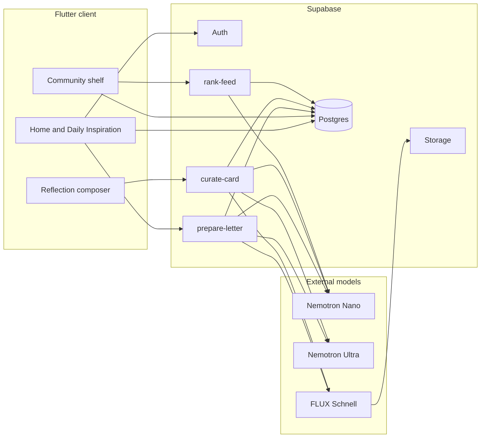
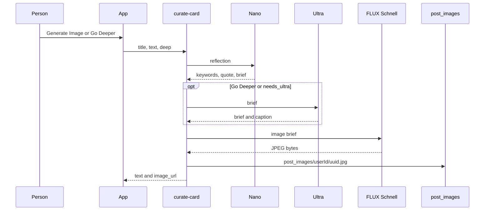
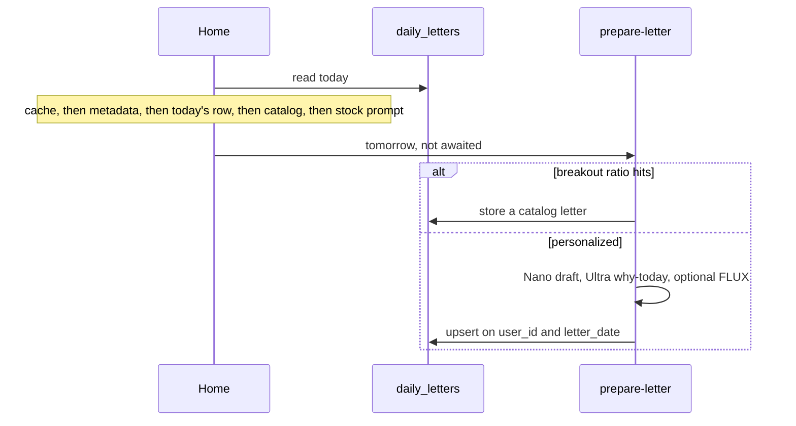

# Architecture

Inspiration Museum is a Flutter client on Supabase. Three Edge Functions call Nebius Token Factory. One of them also calls fal.ai when a picture is needed. The models draft and rank text. They do not paint pixels, and they do not pick their own tools.

## 1. System overview

What each kind of data is:

| Kind | Where it comes from | Shown to the person? |
| --- | --- | --- |
| Declared profile | Typed in Edit Profile and Backstage | Yes, on the profile |
| Behavioral signals | Likes, saves, and published reflections | Not as a model essay |
| Private observation | Nano, stored on the profile as `observed_note` | No |
| Prepared inspiration | Nano, or a catalog letter on the breakout path | Yes, as Daily Inspiration |
| "Why today" | Ultra, when that call succeeds | Yes, when the field is non-empty |
| Reflection card | Nano, then optional Ultra caption and brief | Yes, in the composer |
| Generated image | FLUX, from the brief | Yes, as a preview and, if published, on the collection |
| Published collection | The person confirms publish | Yes, according to its public or private flag |

Opening Home starts tomorrow's letter in the background. That is one prepared job. It is not an autonomous agent.

## 2. Flutter client architecture

`lib/main.dart` starts Supabase with the project URL and the publishable client key, then shows sign-in or the main shell.

| Area | Main files |
| --- | --- |
| Sign-in and session | `lib/auth_screen.dart`, `lib/services/auth_service.dart`, `lib/judge_demo.dart` |
| Home, letter card, discovery | `lib/home_tab.dart`, `lib/daily_letter_card.dart`, `lib/daily_discovery/` |
| Letter selection | `lib/daily_push.dart`, `SupabaseDBService.fetchDailyPush` |
| Reflection and publish | `lib/inspiration_editor_screen.dart`, `lib/services/curation_service.dart` |
| Community shelf | `lib/community_feed.dart` |
| Profile, gallery, drafts, Backstage | `lib/profile_tab.dart`, `lib/profile_gallery_screen.dart`, `lib/letter_drafts_screen.dart`, `lib/curation_backstage_screen.dart` |
| Messages and follows | `lib/chat_tab.dart`, `lib/chat_room_screen.dart`, `lib/follow_list_screen.dart` |
| Data access | `lib/services/db_service.dart` |
| Visual system | `lib/living_canvas/` |

The client never receives `NEBIUS_API_KEY`, `FAL_KEY`, or the service-role key. It calls `functions.invoke` for `curate-card`, `prepare-letter`, and `rank-feed`.

## 3. Supabase database and authentication

Authentication is Supabase email and password. Guest entry uses anonymous sign-in and shows an error if that provider is off. The judge button is compiled only when both `JUDGE_EMAIL` and `JUDGE_PASSWORD` are non-empty.

Tables this client reads or writes include `profiles`, `inspirations`, `messages`, `follows`, `likes`, `saves`, `reposts`, `comments`, `comment_likes`, `themes`, `user_theme_preferences`, `daily_letters`, `letter_drafts`, and `interest_signals`. Ranking uses `feed_ranks` on the server.

Only the later letter and ranking tables are created in `supabase/migrations/`. `profiles` is altered there, which means the base table already existed when those migrations were written. Row Level Security is enabled in these migrations for `daily_letters`, `interest_signals`, `feed_ranks`, and `letter_drafts`. Policies for the older social tables are not in this tree, so this document does not claim they were re-checked here.

Storage buckets used by name are `post_images` and `avatars`. Their policies are not in the migrations.

`get_random_daily_letter` is a Postgres function. Its body is not in the migration directory. The client and `prepare-letter` both call it.

## 4. Edge Function orchestration

All three functions live under `supabase/functions/` and require a user JWT (`verify_jwt = true` plus `auth.getUser()`).

Shared Nebius call:

- `POST https://api.tokenfactory.nebius.com/v1/chat/completions`
- Nano also tries `https://api.tokenfactory.eu-north1.nebius.com/v1/chat/completions`
- Ultra also tries `https://api.tokenfactory.us-central1.nebius.com/v1/chat/completions`
- Header `Authorization: Bearer` and `NEBIUS_API_KEY`
- Body fields include `model`, `messages`, `temperature`, `max_tokens`, and optionally `extra_body.chat_template_kwargs.enable_thinking: false`
- Timeout 50 seconds
- A second round after 800 ms for transient statuses `0`, `404`, `429`, and `5xx`
- The first JSON object in the reply is parsed. `curate-card` has an extra repair path. Thinking tags are stripped.

There is no Nebius AI Cloud or GPU endpoint in this tree, and no OpenAI client.

## 5. Nemotron Nano responsibilities

Model id: `nvidia/NVIDIA-Nemotron-3-Nano-30B-A3B`.

| Function | What Nano must return |
| --- | --- |
| `prepare-letter` | Keyword, quote, and one rotating companion among image, music, city, building, film, and book. Also a one-sentence observation when interest signals changed. |
| `curate-card` | Keywords, quote, image brief, and whether a deeper pass is needed. If this call fails, the whole curation fails. |
| `rank-feed` | An order of ids taken from the public collections it was shown. Unknown ids are dropped. |

Nano does not write the profile fields. It does not publish a collection. A person still confirms publish in the composer.

## 6. Nemotron Ultra responsibilities

Model id: `nvidia/Nemotron-3-Ultra-550b-a55b`.

| Function | What Ultra adds |
| --- | --- |
| `prepare-letter` | One "why today" sentence after the Nano draft. Failure leaves that field empty and still saves the letter. |
| `curate-card` | A tighter image brief and one caption, when Go Deeper is on or Nano sets `needs_ultra`. Failure keeps Nano's brief and an empty caption. |

Keywords and the original quote in a reflection stay from Nano. On publish, a caption is appended under the quote. The composer can show "Refined by Ultra" only when the response says Ultra was used.

## 7. FLUX image-generation workflow

FLUX is called only when a brief exists and `FAL_KEY` is set. Auth is `Authorization: Key`. Generation timeout is 45 seconds. The download timeout is 20 seconds. The JPEG is uploaded to `post_images/{userId}/{uuid}.jpg`. A paint or upload failure sets `image_error` and still returns the text. The client drops a non-http image address.

`prepare-letter` uses the same FLUX endpoint only when the day's companion is an image.

## 8. Daily Inspiration preparation and caching

The same user, date, and interest stamp returns the stored row and does not call the model again. If signals change during painting, the function can return `ready: false, stale: true`, and the client tries once.

`allowedDate` in `prepare-letter` accepts today through two days ahead. The Home screen does not use that to generate the open card. A manual invoke with today's date is possible for an operator. The product path does not do it on open.

The stock fallback in `DailyPush.fallback` uses the keyword `MARGIN` and a fixed quote. It is not written back as a prepared letter. The interface labels it STARTING PROMPT.

## 9. Reflection generation and publishing

1. The person writes in the composer, often starting from the day's letter.
2. Generate Image calls curation with `deep: false`. Go Deeper uses `deep: true`.
3. The editor shows the returned keywords, quote, optional caption, and image preview.
4. Publish inserts an `inspirations` row. A generated http URL is stored as `image_url`. A local photo is uploaded by the client instead. Editing an existing post can attach an uploaded image without creating a new row.

Empty writing does not call the function. Widget tests cover this path with a fake curator. They do not call Nebius or fal.

## 10. Personalized feed ranking

`rank-feed` loads recent public inspirations, sends the portrait and a few interest signals to Nano, and caches the id list in `feed_ranks` for that user while the day, portrait stamp, and catalog stamp match. Only Nano is used.

The client loads the public list by `created_at` descending, then moves the returned ids to the front when those ids are still in the list. Unknown ids cannot add a post. If ranking throws or returns nothing, the shelf uses the person's theme filter, then chronological order. The shelf title stays "For you" in every case. The feed is not generative.

## 11. Fallback and error handling

| Failure | What the product does |
| --- | --- |
| No letter for today | Catalog RPC, then the stock starting prompt |
| Breakout day | Catalog letter, Nano skipped |
| Ultra fails on a letter | Letter saved with an empty "why today" |
| Nano fails on curation | The curation call fails. The editor can offer Try Again |
| Ultra fails on Go Deeper | Nano text is kept |
| FLUX or upload fails | Text returns, `image_error` is set, publish can continue without an image |
| Rank fails | Theme filter, then chronological order |
| `prepare-letter` fails on Home | The error is swallowed. Home still opens |
| Guest provider disabled | The sign-in screen says guest entry is closed |

Timeouts on the model calls are 50 seconds. The client does not show a specific reason when tomorrow's preparation fails.

## 12. Security boundaries

| Secret | Where it may live | Where it must not live |
| --- | --- | --- |
| Publishable Supabase key | Flutter client | Treated as a privileged admin key |
| Service-role key | Edge Function environment | Flutter source, git, logs |
| Nebius API key | Edge Function secret `NEBIUS_API_KEY` | Flutter source |
| fal.ai key | Edge Function secret `FAL_KEY` | Flutter source |
| Personal access token | A gitignored local env file for the CLI | The repository |
| Judge password | A local `--dart-define` at run time | Source |

CORS on the functions allows any origin. JWT verification and `getUser()` still apply. Do not turn off `verify_jwt`.

`.env.local` and `tool/` are gitignored. `tool/` contains local probes, seed scripts, and dumps. Several of those files match token or password patterns. They are not part of the build.

The publishable key in `lib/main.dart` uses the `sb_publishable_` prefix and is passed as `publishableKey`. It is not an `sb_secret_` key. `web/view.html` is an unused static page with a publishable key. It is gitignored and is not part of the Flutter build.
